It is common for researchers to do a literature survey.
Maybe we want to have a comprehensive collection of related works.
Or we need to check if a new idea has been published already.
Sometimes we just want to keep track of the latest trend in some field.

Usually we begin with some keywords or papers we already know.
We can either Google them, or search on Google Scholar to get more scholarly results.
With Google Scholar, I usually climb up the "Cited by" ladder and end up with lots of open tabs, interleaving Google Scholar pages and PDF files.
The process is effective, but neither efficient nor intuitive.
The tabs are linear, whereas the relationship among papers should be like a graph structure.
The good news is that there are already several websites that tackle this problem.

## A comparison

Five competitors (ordered by the time I first try them):
- [Semantic Scholar](https://www.semanticscholar.org/)
- [Connected Papers](https://www.connectedpapers.com/)
- [Litmap](https://www.litmaps.co/)
- [Research Rabbit](https://www.researchrabbit.ai/)
- [Inciteful](https://inciteful.xyz/)

One interesting thing I found (at the time of writing) is that the websites end with different domains: org, com, co, ai, xyz.

### [Semantic Scholar](https://www.semanticscholar.org/)
Semantic Scholar does a great job at curating information about papers, including extracting figures from papers and collecting external presentation slides.
The references and citations are organized neatly, with a search box, many filters, and sorting functionalities.
One drawback is that the literature is presented linearly.

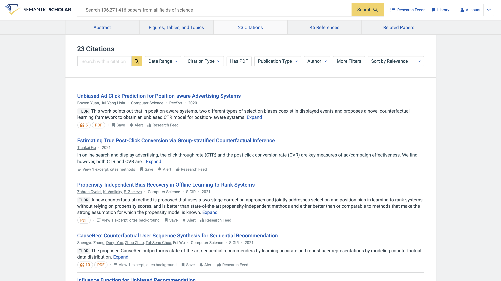

One great feature is the Research Feed.
Some related (and new) papers will be recommended according to some seed papers, and we can rate them to provide signals for the system to recommend better results in the future, creating a feedback loop.

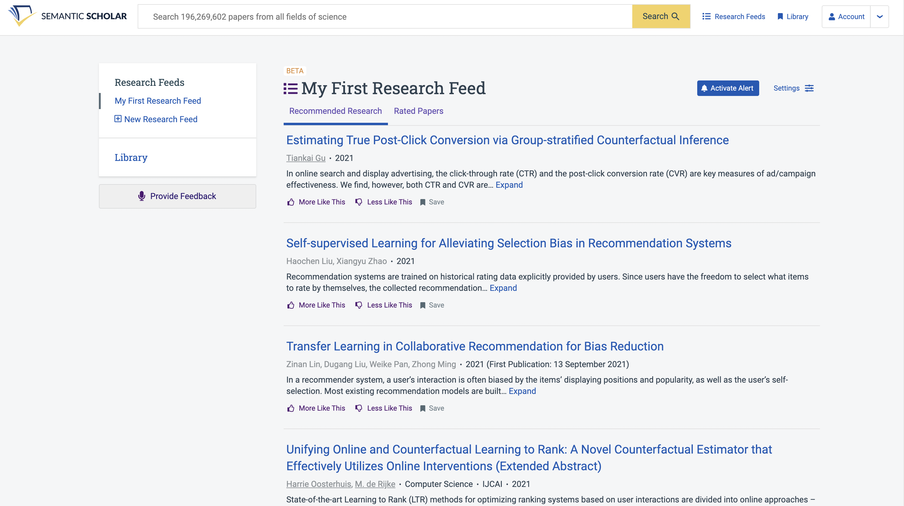

Another cool feature of Semantic Scholar is the Semantic Reader.
When reading a paper, we can quickly view the title, abstract, and other information about citations.
No need to jump back and forth between text and references, or copy and paste the title to search the paper!
This feature is limited to a small fraction of papers, though.

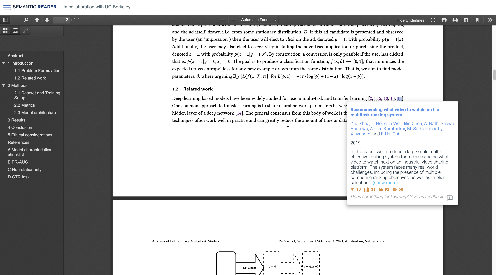

There is no fancy visualization, to be honest.
But I think the Research Feed and Semantic Reader are going to help researchers discover and read papers more efficiently.

### [Connected Papers](https://www.connectedpapers.com/)

Similar to Semantic Scholar, Connected Papers can show the references (prior works) and citations (derivative works) of a paper.

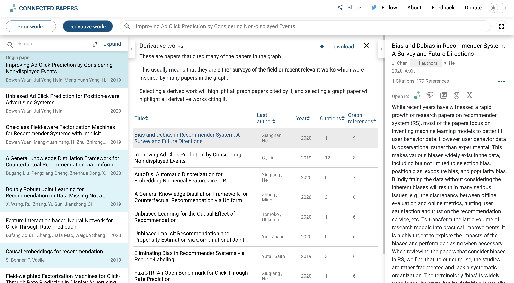

Though the listings UI is not as good as that of Semantic Scholar, the graph UI visualizes the similarity and relationship among related papers (not a citation graph).
Each node is annotated with size (number of citations) and color (publishing year).
Hover over the nodes to see the details in the right panel.

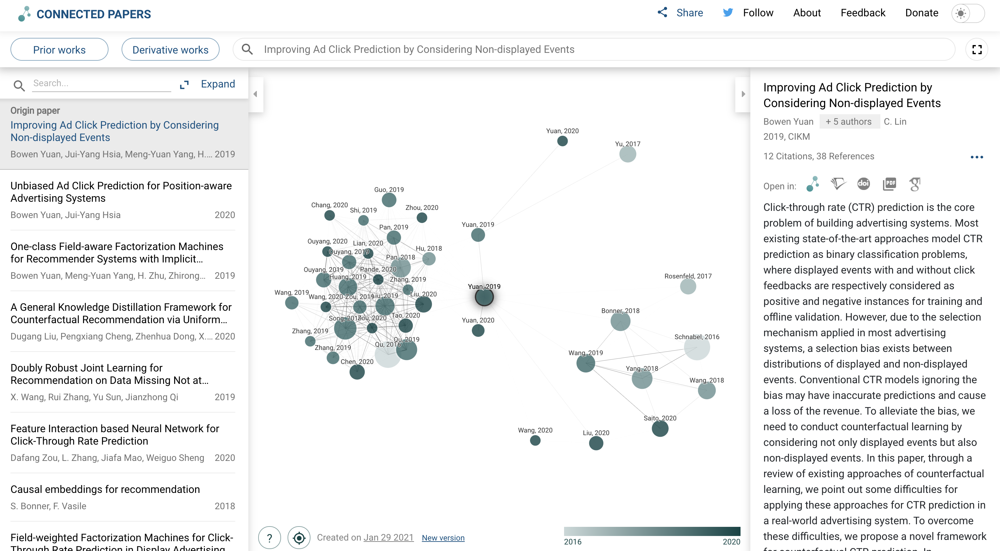

One major drawback is that the visualization only works for one seed paper, and the functionality is similar to that of Google Scholar.

### [Litmap](https://www.litmaps.co/)

Similar to Connect Papers, the papers can be visualized as a graph.
The difference is that Litmap creates a citation graph instead of using similarity.
A great feature I like is the ability to create different maps (the red and orange boxes in the left bar).
Think of each map as a collection of papers with the same topic or field.
One paper can be added to multiple maps.
In each map, we can see the relationship of the papers, including suggested related papers that are not in the map.

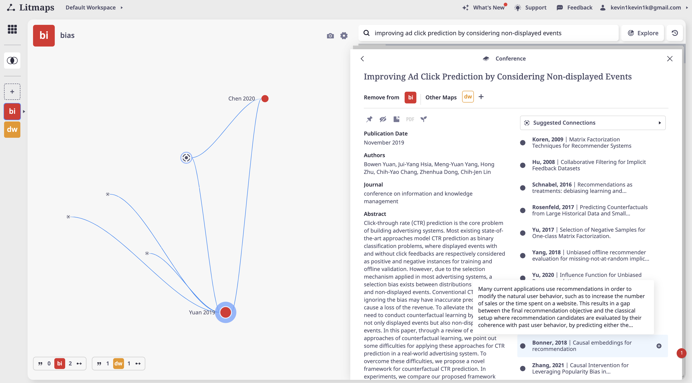

The nodes are organized better than Collected Papers.
Hover over a node to see its references and citations.

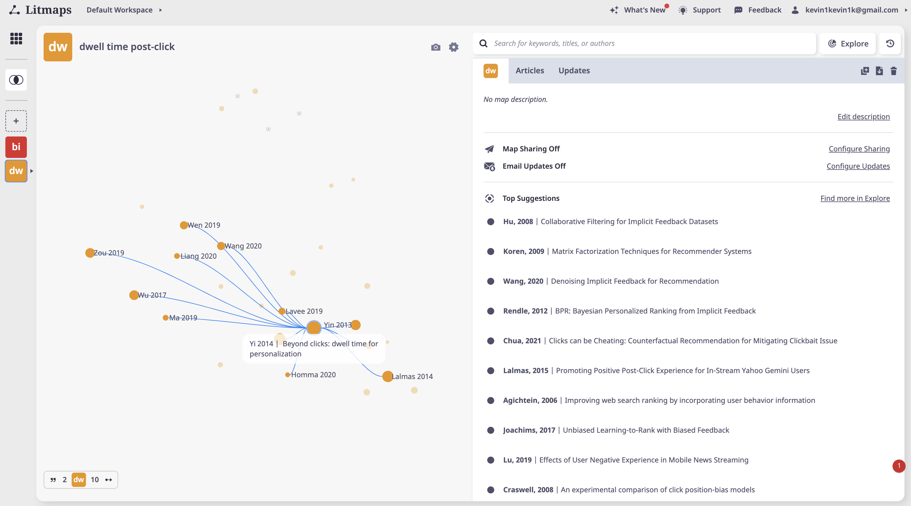

Another cool feature is that we can control the visualization.
For example, we can order the papers horizontally by publishing year, and vertically by title similarity.
This gives a better chronological view of the literature.

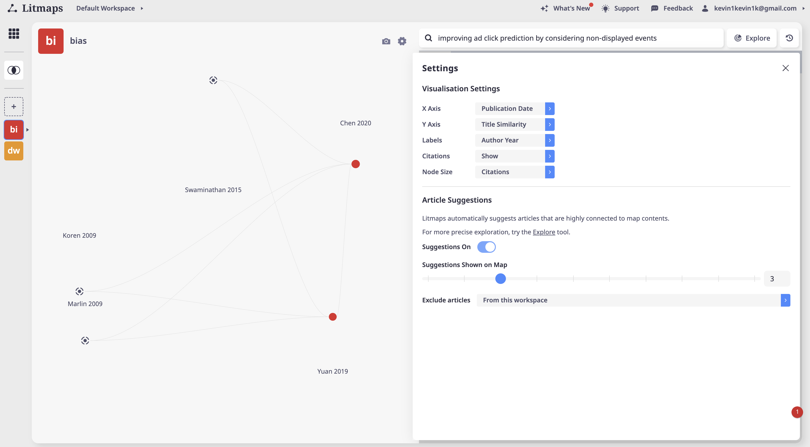

I personally like Litmap the most, in terms of both functionalities and UI.

### [Research Rabbit](https://www.researchrabbit.ai/)

The UI of Research Rabbit is even fancier.
The idea of collections is similar to maps of Litmap.
There are also other functionalities like suggested authors, which I have not tried yet.
The cascading panels grow to the right and seem a bit messy, but this makes it easier to go back to a specific step.

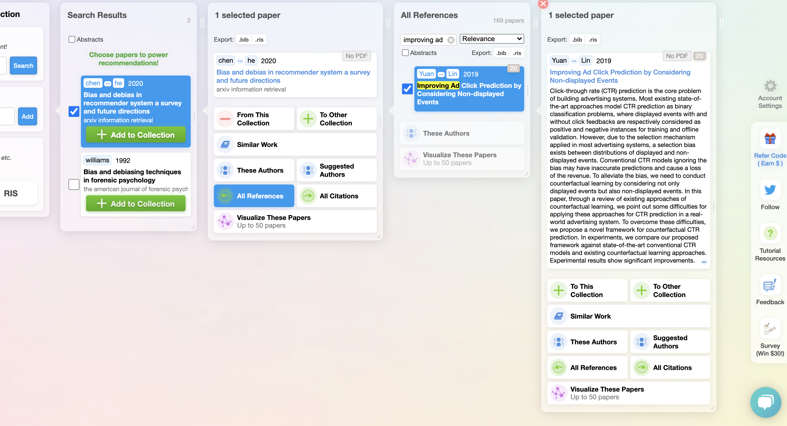

The visualization looks a bit crowded, probably because the first author's name and year are put on the nodes.

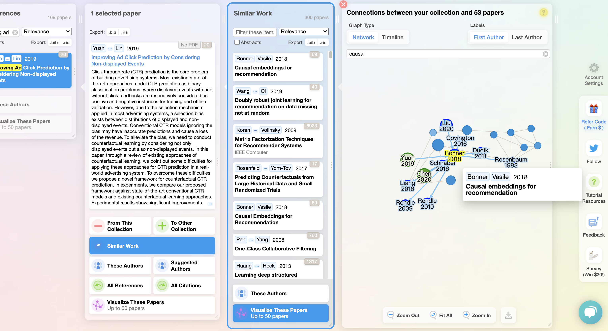

Research Rabbit also enables sorting by publishing year.
However I prefer the display of Litmap, which is less crowded.

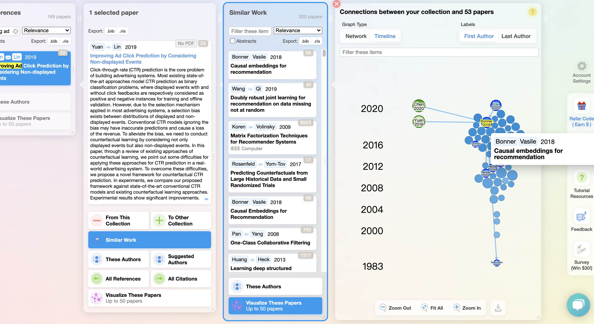

For me it seems Litmap and Research Rabbit are similar, and the latter offers even more features.
But the color and graph presentation of Research Rabbit do not fit my taste.

### [Inciteful](https://inciteful.xyz/)

Inciteful is like Connected Papers that supports multiple seed papers.
Unlike Litmap and Research Rabbit, Inciteful does not have multiple maps or collections.

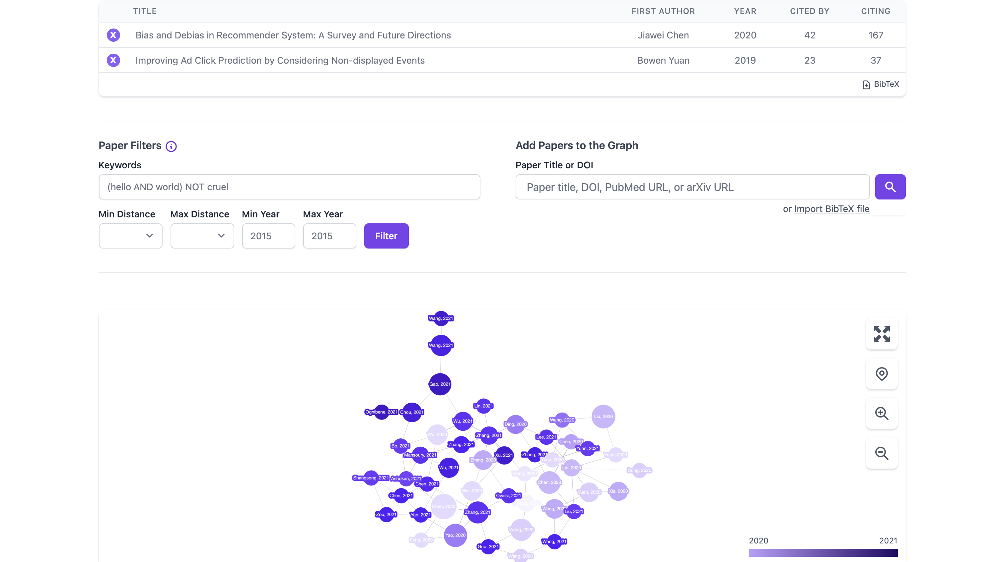

There are some interesting features, such as recent papers by top authors, or most important recent papers (though I wonder how they measure importance).

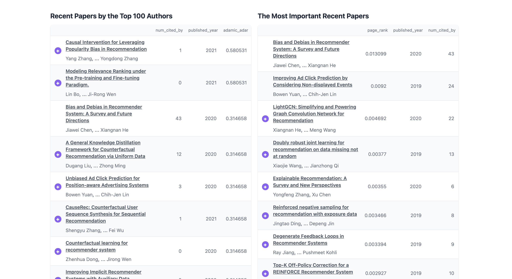

And more information, though not necessarily quite useful.

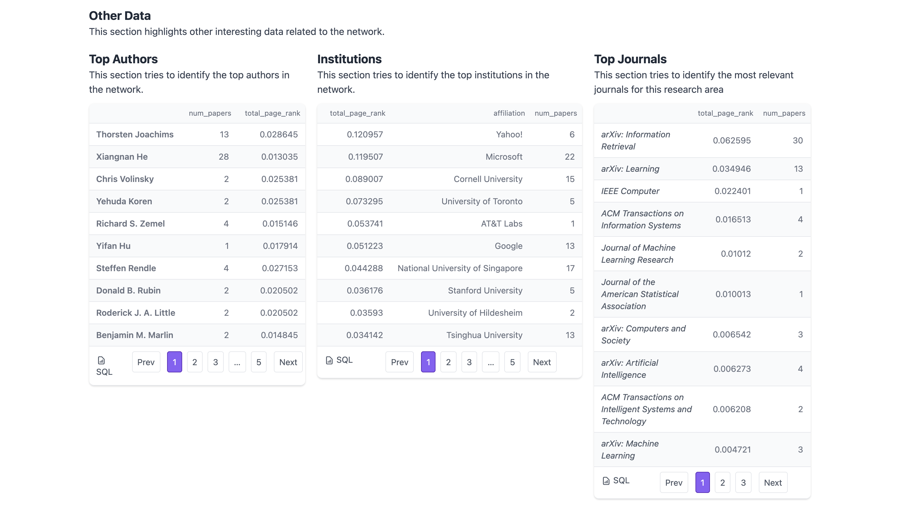

I would say Inciteful is an enhanced version of Connected Papers, but not as powerful as Litmap or Research Rabbit.

## Conclusion

To visualize the related papers of a single paper, Connected Papers is a simple choice.
To build several collections of papers with various directions, I would recommend Litmap and Research Rabbit (I prefer Litmap a bit more).

For more comparisons, you can also visit [this medium post](https://aarontay.medium.com/3-new-tools-to-try-for-literature-mapping-connected-papers-inciteful-and-litmaps-a399f27622a) or [this blog post](https://musingsaboutlibrarianship.blogspot.com/p/list-of-innovative-literature-mapping.html).